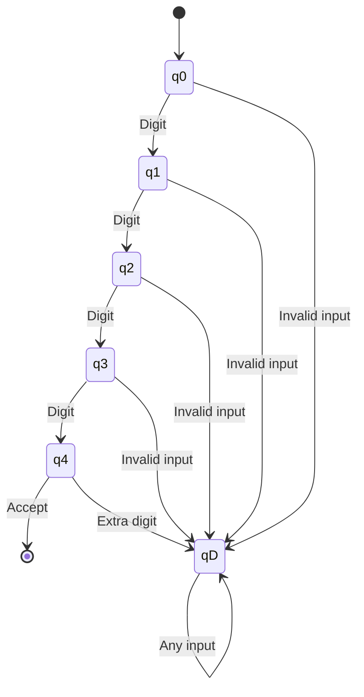
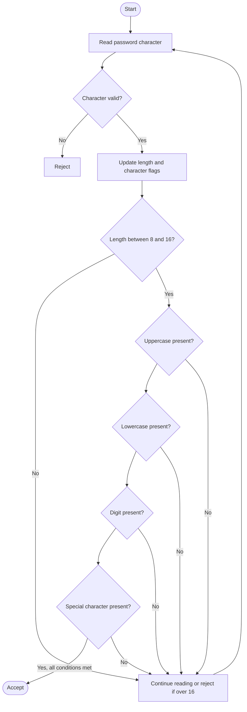
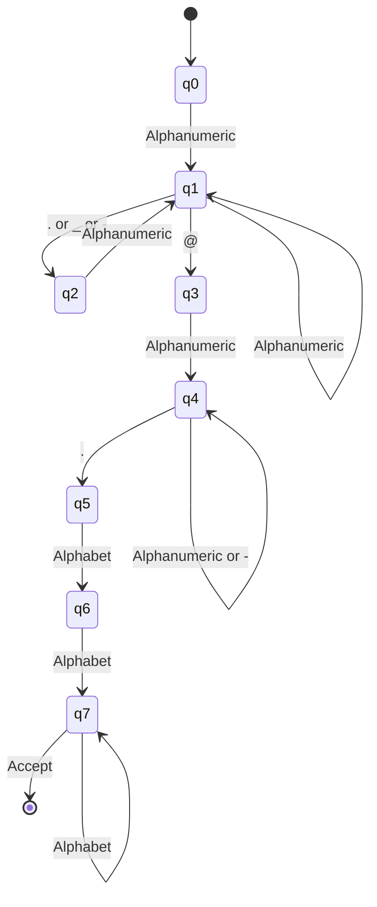
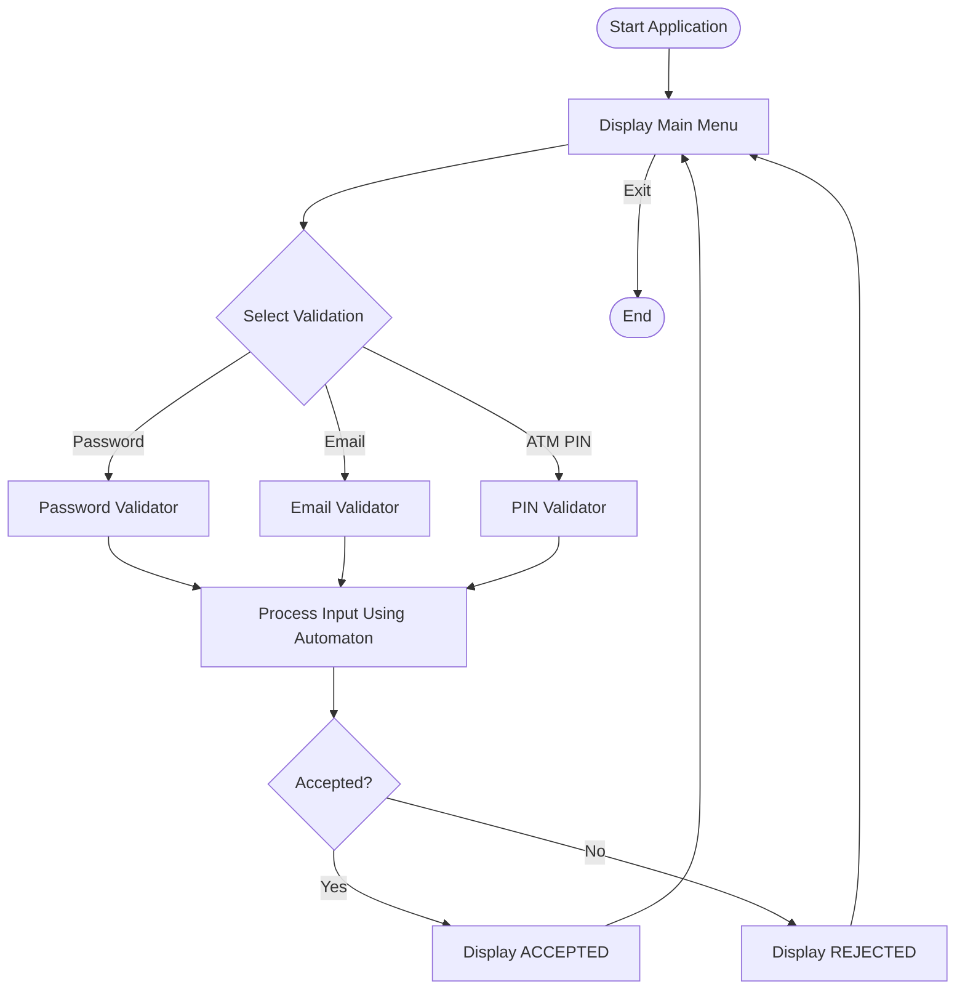

# Finite Automata for Real-Time Validation

**Course:** 21CSC301T Formal Language and Automata  
**Assessment:** CLA-2, Assessment Task 3  
**Student:** K Neeraj (RA2411026050023)  
**Programme:** B.Tech AIML 'A', III Year  
**Faculty:** Dr. C. Gunasundari  
**Institution:** SRM IST Tiruchirappalli

---

## 1. Introduction

Finite Automata are mathematical models used to recognize patterns and validate strings according to predefined rules. This project demonstrates the practical applications of Deterministic Finite Automata (DFA) through three real-time validation applications:

1. ATM PIN validation
2. Password structure validation
3. E-mail syntax validation

Each application uses a finite automaton to process an input string and determine whether it belongs to the specified language.

## 2. Project Overview

| No. | Application | Automaton | Purpose |
|---|---|---|---|
| 1 | ATM PIN Validation | DFA | Checks exactly four digits |
| 2 | Password Validation | DFA-style state tracking | Checks password policy |
| 3 | E-mail Validation | DFA | Checks simplified e-mail syntax |

## 3. ATM PIN Validation

### Target Language

The ATM PIN validator accepts strings containing exactly four numeric digits.

\[
L_{PIN}=\{w \in \{0,1,\ldots,9\}^* \mid |w|=4\}
\]

**Rules:**
- PIN must contain exactly four digits.
- Only numeric characters are accepted.
- Leading zeros are allowed.
- Any non-digit or fifth digit is rejected.

**Examples:**

| Input | Result |
|---|---|
| `1234` | Accepted |
| `0000` | Accepted |
| `2580` | Accepted |
| `123` | Rejected |
| `12345` | Rejected |
| `12a4` | Rejected |

### PIN DFA Diagram



**Explanation:**

- q0 is the initial state.
- q1, q2 and q3 represent the number of digits processed.
- q4 is the accepting state after exactly four digits.
- qD is the dead state for invalid inputs.

## 4. Password Structure Validation

### Target Language

The password validator accepts passwords satisfying the following conditions:

- Length between 8 and 16 characters.
- At least one uppercase letter.
- At least one lowercase letter.
- At least one digit.
- At least one permitted special character.
- Spaces and unsupported characters are not allowed.

Permitted special characters:

```text
!@#$%^&*()-_=+[]{};:,.?/
```

The automaton tracks four character-category conditions and the password length.

\[
L=L_U\cap L_L\cap L_D\cap L_S\cap L_{Length}
\]

Where:

- \(L_U\): Contains an uppercase letter.
- \(L_L\): Contains a lowercase letter.
- \(L_D\): Contains a digit.
- \(L_S\): Contains a permitted special character.
- \(L_{Length}\): Length is between 8 and 16.

### Password State Tracking Diagram



**Examples:**

| Password | Result |
|---|---|
| `Abcdef1!` | Accepted |
| `Hello123@` | Accepted |
| `A1!bcdef` | Accepted |
| `abcdef1!` | Rejected |
| `ABCDEF1!` | Rejected |
| `Abcdef12` | Rejected |

**Explanation:**

The password validator maintains information about the character categories encountered and the total length. The input is accepted only when all required conditions are satisfied.

## 5. E-mail Syntax Validation

### Target Language

The e-mail validator checks a simplified e-mail syntax.

```text
email = username @ domain . extension
```

**Rules:**

- Username must contain alphanumeric characters.
- Dots, underscores and hyphens can separate username parts.
- The `@` symbol is mandatory.
- A valid domain name must be present.
- The extension must contain at least two alphabetic characters.

### E-mail DFA Diagram



**Examples:**

| E-mail | Result |
|---|---|
| `alex@example.com` | Accepted |
| `a1@test.org` | Accepted |
| `john.doe@mail.net` | Accepted |
| `alexexample.com` | Rejected |
| `@example.com` | Rejected |
| `alex@.com` | Rejected |

**Explanation:**

The automaton processes the username, `@` symbol, domain and extension in sequence. It reaches the accepting state only when the required simplified e-mail structure is satisfied.

## 6. Overall Project Workflow



## 7. Technologies Used

- **Programming Language:** Python
- **Concept:** Deterministic Finite Automata
- **Theory:** Formal Languages and Automata
- **Implementation:** Python functions and state-based validation
- **Testing:** Accepted and rejected input examples

## 8. How to Run the Project

### Step 1: Clone the repository

```bash
git clone https://github.com/Neeraj486-eng/FLA-Automata-Validators.git
```

### Step 2: Open the project directory

```bash
cd FLA-Automata-Validators
```

### Step 3: Run the application

```bash
python main.py
```

No third-party libraries are required. Python 3.8 or later is recommended.

## 9. Project Structure

```text
FLA-Automata-Validators/
│
├── main.py
├── README.md
├── requirements.txt
│
├── diagrams/
│   ├── password_dfa.md
│   ├── email_dfa.md
│   └── pin_dfa.md
│
└── test_cases/
    └── test_cases.md
```

## 10. Testing

The project includes test cases for all three validation applications.

- Password validation: Checks length and character-category requirements.
- E-mail validation: Checks the simplified e-mail structure.
- ATM PIN validation: Checks exactly four numeric digits.

Both accepted and rejected test cases are provided in the `test_cases` directory.

## 11. Syntax Validation vs. Real-World Verification

Finite Automata determine whether an input follows a defined pattern. However, syntax validation does not guarantee real-world validity.

- Password validation checks the password format, not user authentication.
- E-mail validation checks simplified syntax, not whether the mailbox exists.
- ATM PIN validation checks the four-digit format, not the actual PIN stored by a bank.

## 12. Conclusion

This project demonstrates the practical application of Finite Automata in real-time input validation. By designing separate automata for password structure, e-mail syntax and ATM PIN format, theoretical concepts from Formal Languages and Automata are connected with practical programming applications.

The project highlights how state transitions, accepting states and rejected states can be used to recognize valid input patterns.

---

**Developed by:** K Neeraj  
**Register Number:** RA2411026050023  
**SRM IST Tiruchirappalli**
