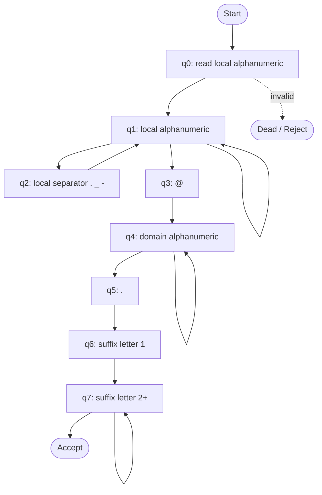

# Simplified Email DFA

The diagram represents the simplified grammar used by `email_dfa`. `qA` is the accepting state; invalid transitions lead to the dead state `qD`.

The implementation also rejects repeated or trailing local-part separators and requires exactly one `@` and one domain dot.
