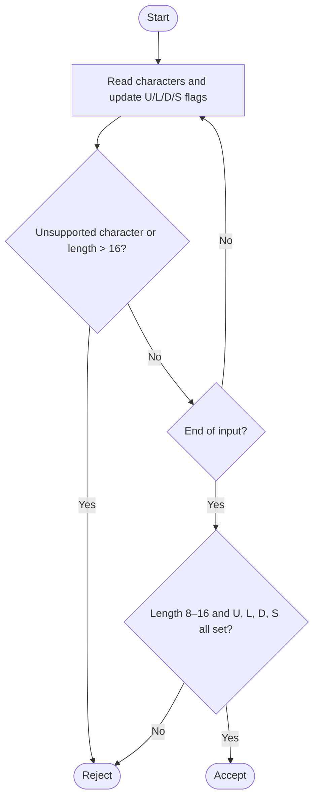

# Password DFA (conceptual state model)

The validator tracks the input length and four flags: uppercase (U), lowercase (L), digit (D), and special character (S). The accepting condition is reached only when the length is 8–16 and all four flags are set. Any unsupported character or length beyond 16 leads to rejection.

This is a compact conceptual representation of a product DFA; each distinct combination of length and flags corresponds to a state.
